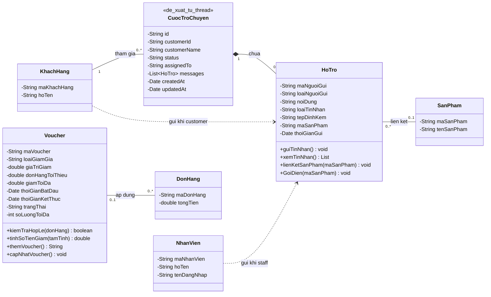

# Các lớp của chức năng Voucher và Support Chat

Tài liệu dùng để vẽ lại sơ đồ lớp trong draw.io. Tên lớp và thành phần nghiệp vụ lấy từ `docs/Class_Diagram.drawio`, đối chiếu với mã nguồn hiện tại:

- `assets/js/user/payment/voucher.js`
- `assets/js/user/support-chat.js`
- `Admin/assets/js/support-chat.js`
- `assets/js/user/payment/checkout.js` và `payment.js` để xác định cách dùng voucher khi đặt hàng.

Mã JavaScript hiện dùng object và hàm trong IIFE, chưa khai báo các lớp bằng từ khóa `class`. Các lớp bên dưới là mô hình UML của dữ liệu và hành vi đó. Ký hiệu `-` là thuộc tính riêng, `+` là phương thức công khai; đây là quy ước khi vẽ UML, không mô tả cơ chế truy cập hiện tại của JavaScript.

## 1. Lớp Voucher

Đại diện cho một mã giảm giá áp dụng khi thanh toán.

### Thuộc tính trong sơ đồ gốc

| Thuộc tính | Kiểu UML | Ý nghĩa | Đối chiếu mã hiện tại |
| --- | --- | --- | --- |
| maVoucher | String | Mã giảm giá | Đã có; dùng để tìm và lưu mã được chọn |
| loaiGiamGia | String | Loại giảm giá | Đã có: `percent` hoặc `fixed` |
| giaTriGiam | double | Phần trăm hoặc số tiền giảm | Đã có |
| donHangToiThieu | double | Giá trị đơn tối thiểu | Đã có |
| giamToiDa | double | Giới hạn số tiền giảm | Có ở mã giảm phần trăm; có thể không khai báo |
| thoiGianBatDau | Date | Thời điểm bắt đầu hiệu lực | Có trong sơ đồ, chưa triển khai trong JS |
| thoiGianKetThuc | Date | Thời điểm kết thúc hiệu lực | Có trong sơ đồ, chưa triển khai trong JS |
| trangThai | String | Trạng thái voucher | Có trong sơ đồ, chưa triển khai trong JS |
| soLuongToiDa | int | Giới hạn số lượt sử dụng | Có trong sơ đồ, chưa triển khai trong JS |

JS còn có `title` và `description` phục vụ hiển thị. Hai trường này chưa có trong lớp Voucher của sơ đồ gốc; có thể bổ sung nếu cần vẽ chi tiết theo mã nguồn.

### Phương thức trong sơ đồ gốc

| Phương thức | Kiểu trả về | Đối chiếu mã hiện tại |
| --- | --- | --- |
| kiemTraHopLe(donHang) | boolean | `ShopVoucher.apply(maVoucher, tamTinh)` kiểm tra mã tồn tại và mức giảm lớn hơn 0; chưa kiểm tra thời hạn, trạng thái hay số lượt |
| tinhSoTienGiam(tamTinh) | double | Tương ứng `getDiscount(voucher, tamTinh)`, được công khai qua `ShopVoucher.discount` |
| themVoucher() | String | Chưa triển khai; danh sách đang khai báo sẵn |
| capNhatVoucher() | void | Chưa triển khai |

`ShopVoucher` là API dùng chung của module, cung cấp `list()`, `find(maVoucher)`, `discount(voucher, tamTinh)`, `getApplied()`, `apply(maVoucher, tamTinh)` và `clear()`. Không nhầm các hàm quản lý danh sách/mã đang chọn với phương thức của từng đối tượng Voucher.

### Quy tắc nghiệp vụ đang có

- Chuẩn hóa mã bằng cách bỏ khoảng trắng hai đầu và chuyển thành chữ hoa.
- Không giảm nếu đơn chưa đạt `donHangToiThieu`.
- `percent`: số tiền giảm bằng `tamTinh * giaTriGiam / 100`, có giới hạn `giamToiDa` nếu được khai báo.
- `fixed`: giảm trực tiếp `giaTriGiam`.
- Mức giảm cuối cùng nằm trong khoảng từ 0 đến `tamTinh`.
- Mã đang chọn lưu tại khóa `appliedVoucher` trong localStorage, dưới dạng `{ maVoucher }`.
- Mỗi đơn hàng hiện chỉ ghi nhận tối đa một voucher.

## 2. Lớp HoTro

Trong cách lưu dữ liệu hiện tại, mỗi đối tượng HoTro tương ứng **một tin nhắn**, nằm trong `thread.messages`. Một cuộc trò chuyện chứa nhiều tin nhắn HoTro.

### Thuộc tính trong sơ đồ gốc

| Thuộc tính | Kiểu UML | Ý nghĩa và giá trị hiện tại |
| --- | --- | --- |
| maNguoiGui | String | Khách gửi: `user.maKhachHang`; nhân viên gửi: `staff.username` |
| loaiNguoiGui | String | `customer` hoặc `staff` |
| noiDung | String | Nội dung văn bản; với ảnh là tên tệp |
| loaiTinNhan | String | `text`, `image` hoặc `product` |
| tepDinhKem | String | Data URL của ảnh; dùng cho tin nhắn ảnh |
| maSanPham | String | Mã sản phẩm; dùng cho tin nhắn sản phẩm |
| thoiGianGui | Date | Thời gian gửi; JS lưu chuỗi ISO |

Sơ đồ gốc có một dòng `- String` chưa ghi tên thuộc tính. Không dùng dòng thiếu tên này khi vẽ lại. Trong JS mỗi tin nhắn có `id`; nếu cần định danh trong UML, bổ sung `-String id` và ghi rõ đây là trường lấy từ mã nguồn.

Các trường bổ sung đang có trong JS: `senderName` (tên người gửi), `name` (tên sản phẩm), `url` (liên kết sản phẩm). Chúng chưa được khai báo trong lớp HoTro của sơ đồ gốc.

### Phương thức trong sơ đồ gốc

| Phương thức | Kiểu trả về | Đối chiếu mã hiện tại |
| --- | --- | --- |
| guiTinNhan() | void | Khách: `addMessage(threadId, message)`; admin: hàm `add(message)` |
| xemTinNhan() | List | Đọc hội thoại qua `readThreads()` / `read()`, sau đó hiển thị bằng `render()` |
| lienKetSanPham(maSanPham) | void | Tìm sản phẩm trong `productsLocal`, tạo tin nhắn loại `product` |
| GoiDien(maSanPham) | void | Chữ ký trong sơ đồ gốc; JS thực tế dùng `openCall(thread, displayName)` |

Giữ nguyên chữ hoa `GoiDien` nếu cần sao chép đúng sơ đồ gốc. Nếu vẽ theo triển khai hiện tại, nên sửa chữ ký thành `goiDien(maCuocTroChuyen)` vì phòng gọi được tạo từ `thread.id`, không dùng mã sản phẩm. Đây là đề xuất chỉnh sơ đồ, chưa phải thay đổi trong file draw.io.

### Quy tắc nghiệp vụ đang có

- Khách phải đăng nhập mới khởi tạo giao diện chat.
- Tái sử dụng hội thoại chưa đóng của khách; nếu chưa có thì tạo mới với trạng thái `open`.
- Tin nhắn văn bản được loại bỏ khoảng trắng hai đầu; ô nhập giới hạn 1.000 ký tự.
- Bộ chọn tệp nhận ảnh; mã kiểm tra kích thước không vượt quá 2 MB.
- Tin nhắn sản phẩm chỉ được tạo khi tìm thấy mã trong `productsLocal`.
- Khi nhân viên gửi tin, `assignedTo` được cập nhật bằng tên hiển thị của nhân viên.
- Hội thoại lưu ở khóa `supportThreads`; sự kiện `storage` cập nhật giao diện giữa các tab cùng origin. Chưa có backend chat giữa các thiết bị.
- Cuộc gọi dùng Jitsi, phòng có tên sinh từ ID hội thoại. Hiện chưa lưu lịch sử cuộc gọi thành một thực thể riêng.

## 3. Các lớp liên quan và quan hệ để vẽ

| Quan hệ | Bội số | Ý nghĩa và căn cứ |
| --- | --- | --- |
| Voucher — DonHang | Một đơn có `0..1` voucher; một voucher có thể được dùng bởi `0..*` đơn | Suy ra từ `maVoucher` và thông tin voucher được ghi khi tạo đơn |
| KhachHang — CuocTroChuyen | Một khách có `0..*` hội thoại; mỗi hội thoại có `1` khách | Từ `thread.customerId`; mã hiện tìm một hội thoại chưa đóng để tái sử dụng |
| CuocTroChuyen ◆— HoTro | Một hội thoại chứa `0..*` tin nhắn; mỗi tin thuộc `1` hội thoại | Quan hệ hợp thành, từ mảng `thread.messages` |
| KhachHang → HoTro | Một khách gửi `0..*` tin nhắn | Chỉ áp dụng khi `loaiNguoiGui = customer` |
| NhanVien → HoTro | Một nhân viên gửi `0..*` tin nhắn | Chỉ áp dụng khi `loaiNguoiGui = staff`; JS đang dùng username để định danh |
| HoTro — SanPham | Một tin nhắn liên kết `0..1` sản phẩm; một sản phẩm xuất hiện trong `0..*` tin nhắn | Từ `maSanPham` của tin nhắn loại `product` |

Các quan hệ trên được suy ra từ luồng JS để hướng dẫn vẽ; không khẳng định tất cả đã tồn tại trong file draw.io. Mỗi tin nhắn chỉ có một người gửi: khách hàng hoặc nhân viên, xác định bằng cặp `loaiNguoiGui` và `maNguoiGui`. Không vẽ hai người cùng gửi một tin.

`CuocTroChuyen` là lớp bổ sung đề xuất để biểu diễn object `thread`; chưa có tên lớp này trong sơ đồ gốc. Khi vẽ lớp này theo mã hiện tại, dùng:

| Thuộc tính | Kiểu UML | Ý nghĩa |
| --- | --- | --- |
| id | String | Mã hội thoại |
| customerId | String | Mã khách hàng |
| customerName | String | Tên khách hàng |
| status | String | Trạng thái; khởi tạo `open`, kiểm tra khác `closed` |
| assignedTo | String | Tên nhân viên hỗ trợ, có thể null; chưa phải mã nhân viên |
| messages | List~HoTro~ | Các tin nhắn của hội thoại |
| createdAt | Date | Ngày tạo, lưu chuỗi ISO |
| updatedAt | Date | Lần cập nhật gần nhất, lưu chuỗi ISO |

Không dùng `assignedTo` làm khóa ngoại đến `NhanVien.maNhanVien`, vì giá trị hiện tại chỉ là tên hiển thị. Có thể bổ sung quan hệ phân công sau khi thiết kế mã nhân viên phụ trách rõ ràng.

## 4. Sơ đồ Mermaid để dựng lại

Sơ đồ dưới giữ thuộc tính/phương thức của Voucher và HoTro theo draw.io, đồng thời bổ sung CuocTroChuyen và các quan hệ suy ra từ JS. Những thành phần chưa triển khai đã được nêu ở các bảng trên. Các lớp KhachHang, NhanVien, SanPham, DonHang chỉ hiển thị các thuộc tính liên quan đến hai chức năng.

Khi vẽ thủ công, tạo mỗi lớp với ba ngăn: tên lớp, thuộc tính, phương thức. Đặt bội số sát đầu quan hệ tương ứng; hình thoi đặc nằm ở phía CuocTroChuyen. Nếu chỉ cần trích nguyên hai lớp từ sơ đồ gốc thì dùng Voucher và HoTro ở khối trên, bỏ lớp bổ sung và các quan hệ suy ra.
